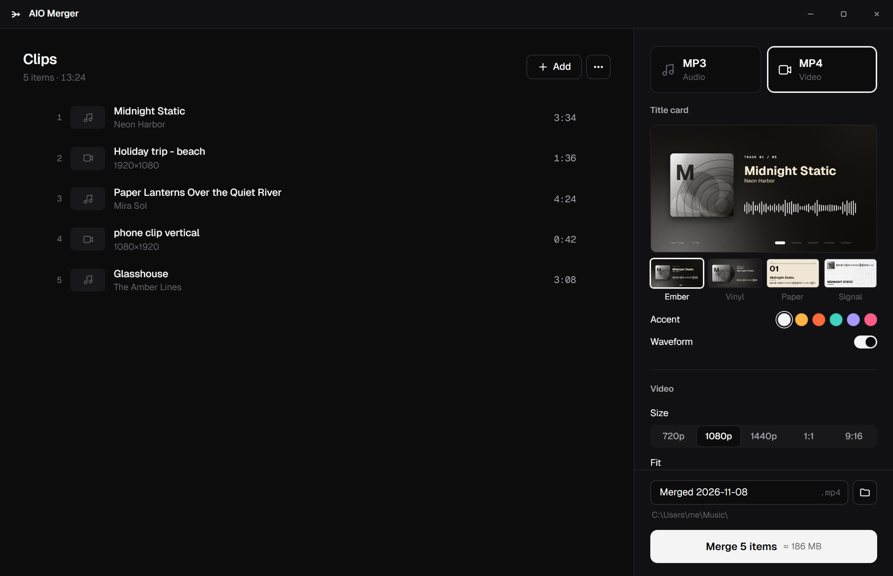
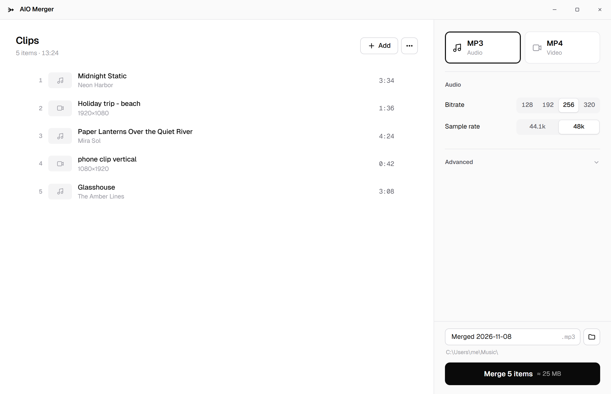
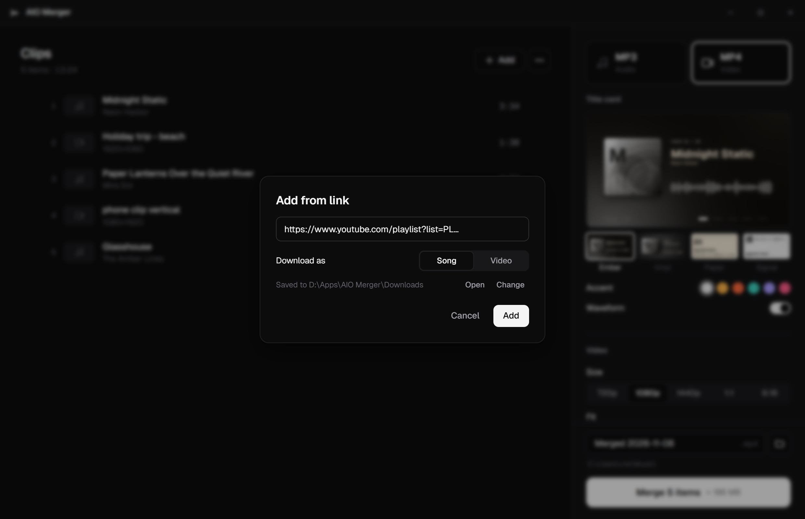
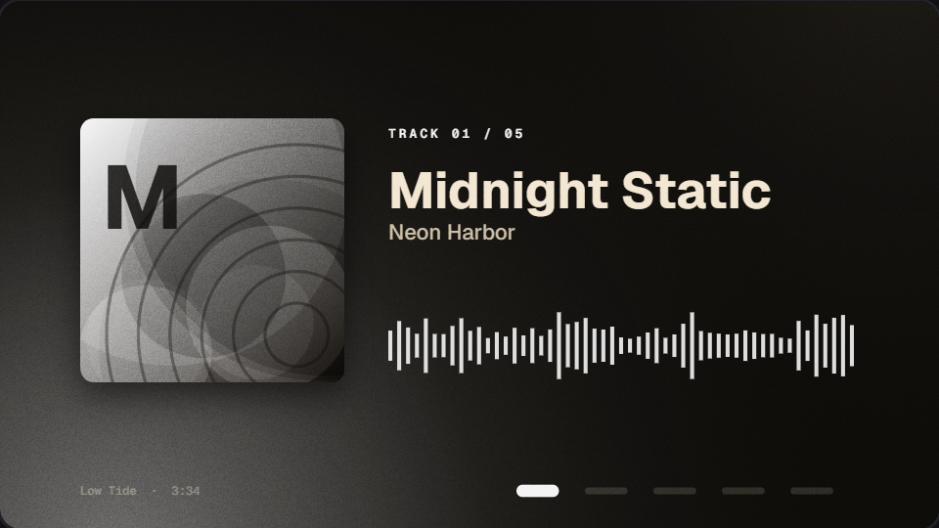
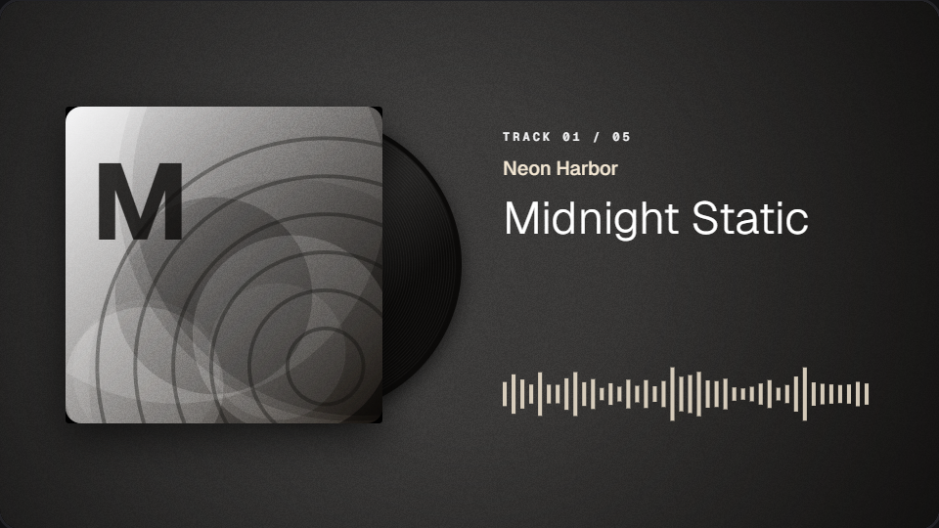
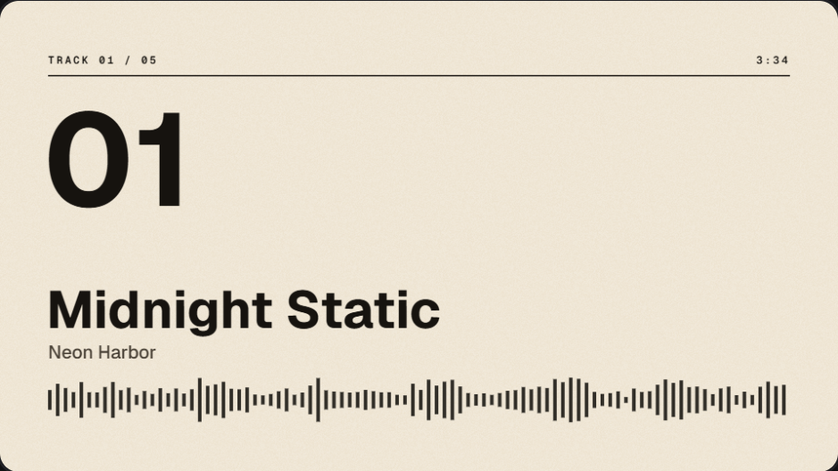
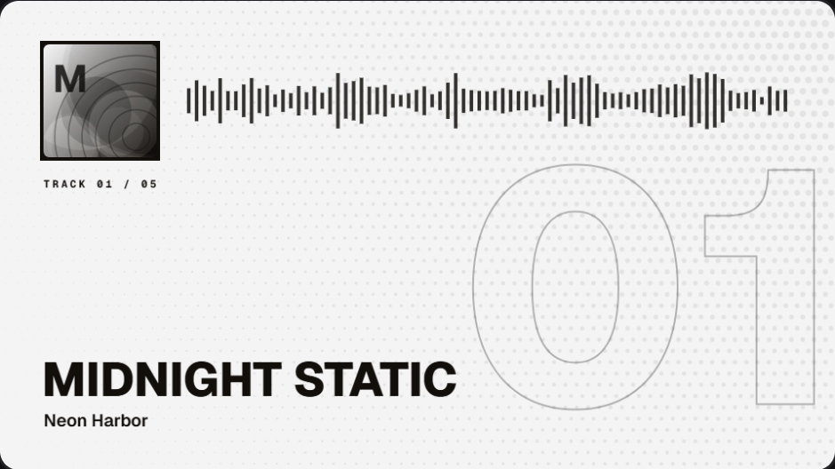
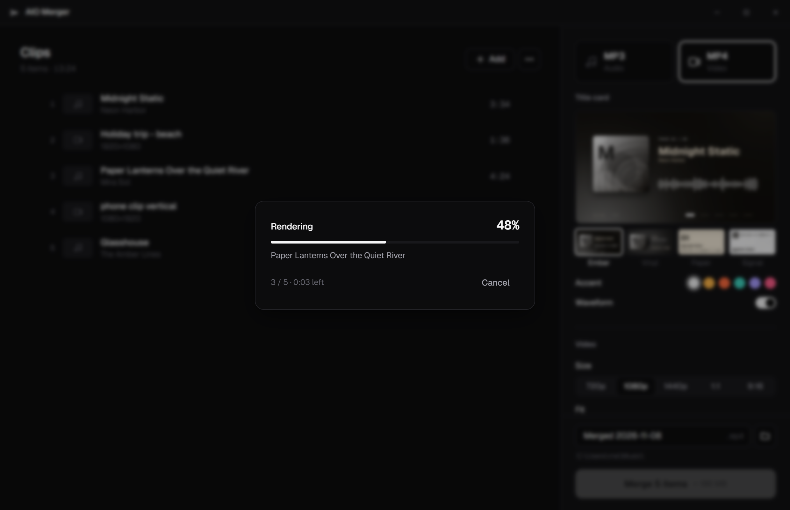

<div align="center">


# AIO Merger

**Drop in songs and videos. Get back one MP3 or one MP4.**

A small, fast desktop app for joining any mix of audio and video files into a single file,<br/>
with clean title cards for songs, YouTube link downloads, and GPU encoding.

[](#-download)
[](#-download)
[](https://tauri.app)
[](https://ffmpeg.org)
[](LICENSE)

[Download](#-download) · [Features](#-features) · [Title cards](#-title-cards) · [Build from source](#-build-from-source)

<br/>

<picture>
  <source media="(prefers-color-scheme: dark)" srcset="docs/screenshots/main-dark.png" />
  <source media="(prefers-color-scheme: light)" srcset="docs/screenshots/main-light.png" />
  
</picture>

</div>

<br/>

## ✨ Features

|   |   |
|---|---|
| 🎚️ **Mix anything** | MP3, WAV, FLAC, M4A, OGG, OPUS… and MP4, MKV, MOV, WEBM, AVI… in one list. Drop whole folders; files sort naturally (`track 2` before `track 10`). |
| 🎵 **One MP3** | Video audio is extracted, every source is decoded losslessly and encoded **once**, so joins stay gapless. |
| 🎬 **One MP4** | Videos are fitted to one frame size (blur-fill, letterbox or crop). Songs get a **title card** with cover art, title, artist and an optional live waveform. |
| 🔗 **YouTube links** | Paste a video or playlist link (`Ctrl+V` anywhere) and pick *Song* or *Video*. Title, channel and thumbnail are embedded, so title cards fill themselves in. |
| ⚡ **Lossless join** | If every file already matches the output, they're joined with no re-encoding, in seconds. |
| 🖥️ **GPU encoding** | NVIDIA NVENC, Intel Quick Sync and AMD AMF are detected automatically. |
| 📑 **Chapters** | One chapter marker per source file, in both MP3 and MP4. |
| 🌗 **Light & dark** | A quiet monochrome UI that follows your system theme. |

<div align="center">


</div>

## 🖼️ Title cards

When songs end up in an MP4, each one gets a rendered title card for its whole length.
Pick a template and an accent colour, and toggle the waveform. Frame sizes include 720p, 1080p, 1440p, square (1:1) and vertical (9:16).

<table>
  <tr>
    <td align="center"><br/><sub><b>Ember</b></sub></td>
    <td align="center"><br/><sub><b>Vinyl</b></sub></td>
  </tr>
  <tr>
    <td align="center"><br/><sub><b>Paper</b></sub></td>
    <td align="center"><br/><sub><b>Signal</b></sub></td>
  </tr>
</table>

## 📦 Download

Grab the latest build from the [**Releases**](../../releases) page.

| Platform | File | FFmpeg |
|---|---|---|
| **Windows 10/11** | `AIO Merger_x.y.z_x64-setup.exe` | Bundled. Nothing else to install |
| **Debian / Ubuntu** | `.deb` | Pulled in as a dependency |
| **Fedora / openSUSE** | `.rpm` | Pulled in as a dependency |
| **Any Linux** | `.AppImage` | Install `ffmpeg` from your package manager |

> [!NOTE]
> The Windows installer is per-user (no admin prompt) and lets you choose the install folder.
> YouTube downloads are saved to a `Downloads` folder next to the app by default; change it any time in **⋯ → Add from link… → Change**.

## 🚀 Using it

1. **Add clips.** Drop files or folders onto the window, click **Add** (`Ctrl+O`), or paste a YouTube link.
2. **Arrange them.** Drag to reorder, or use **⋯** to sort by name or length, or reverse.
3. **Pick MP3 or MP4** on the right, plus a title card style if you're making a video.
4. **Merge** (`Ctrl+Enter`). A progress window shows the current clip and time left, and you can cancel any time.

<div align="center">

</div>

<details>
<summary><b>⌨️ Keyboard shortcuts</b></summary>

<br/>

| Keys | Action |
|---|---|
| `Ctrl+O` | Add files |
| `Ctrl+V` | Add from a copied YouTube link |
| `Ctrl+A` | Select all clips |
| `Ctrl+↑` / `Ctrl+↓` | Move the selected clip |
| `Del` | Remove selected clips |
| `Ctrl+Enter` | Merge |
| Double-click a clip | Play it in your default player |

</details>

<details>
<summary><b>🔗 How YouTube downloads work</b></summary>

<br/>

On first use the app fetches [yt-dlp](https://github.com/yt-dlp/yt-dlp) and [Deno](https://deno.com) (which yt-dlp needs to solve YouTube's player challenges) into its own data folder. yt-dlp updates itself once per session.

- **Song** downloads the best audio track (M4A).
- **Video** downloads H.264 video capped at your chosen output height, so nothing is downloaded bigger than it will be rendered.
- Playlists are expanded into one clip per video (up to 300), downloaded one at a time.
- Files already in the download folder are reused instead of downloaded again.

Only download content you have the right to. YouTube's terms of service restrict downloading.

</details>

## 🛠️ Build from source

**You'll need:** [Rust](https://rustup.rs) (stable), [Node.js](https://nodejs.org) 18+, and on Windows the [MSVC Build Tools](https://visualstudio.microsoft.com/visual-cpp-build-tools/).

```bash
git clone https://github.com/VulKan-42069/aio-merger.git
cd aio-merger
npm install
```

<table>
<tr><th>Windows</th><th>Linux (Debian/Ubuntu)</th></tr>
<tr>
<td>

```bash
npm run fetch-ffmpeg   # FFmpeg for the installer
npm run build
```

</td>
<td>

```bash
sudo apt install libwebkit2gtk-4.1-dev \
  libgtk-3-dev librsvg2-dev \
  libappindicator3-dev patchelf ffmpeg
npm run build
```

</td>
</tr>
</table>

Installers land in `src-tauri/target/release/bundle/`.

**Development:** `npm run dev` starts the app with live reload. To work on the UI alone, serve `src/` with any static server (e.g. `python -m http.server -d src`). A mock backend (`src/dev-mock.js`) kicks in automatically outside Tauri.

**Releases:** push a tag like `v1.0.0` and [GitHub Actions](.github/workflows/build.yml) builds Windows and Linux installers and attaches them to a draft release.

**FFmpeg lookup order:** `AIO_MERGER_FFMPEG_DIR` → bundled `resources/ffmpeg/` → next to the executable → `PATH`.

<details>
<summary><b>📁 Project layout</b></summary>

<br/>

```
src/                    Frontend: plain HTML/CSS/JS, no build step
├─ index.html
├─ app.js               UI logic: clip list, drag-reorder, settings, merge & download flow
├─ templates.js         Title-card templates (canvas)
├─ styles.css           Monochrome styles, light + dark
├─ dev-mock.js          Fake backend for browser-only UI work
└─ fonts/               Geist, Geist Mono
src-tauri/
├─ src/
│  ├─ merge.rs          Merge engine: fast path, MP3 & MP4 pipelines, progress, cancel
│  ├─ probe.rs          Media metadata via ffprobe
│  ├─ ytdl.rs           yt-dlp + Deno setup, link resolving, downloads
│  ├─ commands.rs       Dialogs, thumbnails, encoder detection
│  └─ ffmpeg.rs         Locating & spawning ffmpeg/ffprobe (no console windows)
├─ tauri.conf.json      App config (+ .windows / .linux overrides)
└─ installer/           NSIS installer artwork
scripts/
├─ fetch-ffmpeg.mjs     Downloads the FFmpeg build bundled on Windows
└─ make-installer-art.py
```

</details>

## 📄 License

AIO Merger is released under the [GNU GPL v3.0](LICENSE).

- **FFmpeg:** the Windows installer bundles a GPL build from [BtbN/FFmpeg-Builds](https://github.com/BtbN/FFmpeg-Builds); its licence ships alongside it as `FFMPEG-LICENSE.txt`.
- **Fonts:** [Geist & Geist Mono](https://vercel.com/font) under the SIL Open Font License.
- **yt-dlp** (Unlicense) and **Deno** (MIT) are downloaded at runtime and are not part of this repository.

<div align="center">
<br/>
<sub>Built with Rust, Tauri and FFmpeg.</sub>
</div>
